# Práctica: Seguridad en el DNS
**Módulo 037 Seguridad en servicios - Ciclo Formativo ASIX**

## 1. Entorno e Infraestructura
Para la realización de esta práctica se ha desplegado un laboratorio con dos máquinas virtuales interconectadas a través de una Red Interna en VirtualBox, simulando una red corporativa aislada.

*   **Ubuntu Server (Rol: Servidor DNS, DHCP y Router NAT):**
    *   **Adaptador 1 (NAT - `enp0s3`):** Obtiene IP dinámica (`10.0.2.15`) y proporciona salida a Internet al servidor.
    *   **Adaptador 2 (Red Interna - `enp0s8`):** IP estática `192.168.6.25`. Actúa como puerta de enlace para el cliente.
    *   **Servicios:** Enrutamiento IP (`ip_forward=1`), reglas `iptables` para NAT y servicio `dnsmasq` (DHCP + DNS reenviador a 8.8.8.8).
*   **Debian 13 (Rol: Cliente):**
    *   **Adaptador 1 (Red Interna - `enp0s8`):** IP estática `192.168.6.50`. Puerta de enlace y DNS apuntando a `192.168.6.25`.

### Configuración y verificación del Servidor Ubuntu

**1. Configuración de interfaces de red (Netplan):**
Asignación de IP estática a la interfaz de red interna (`enp0s8`) y salida a Internet por la interfaz NAT.
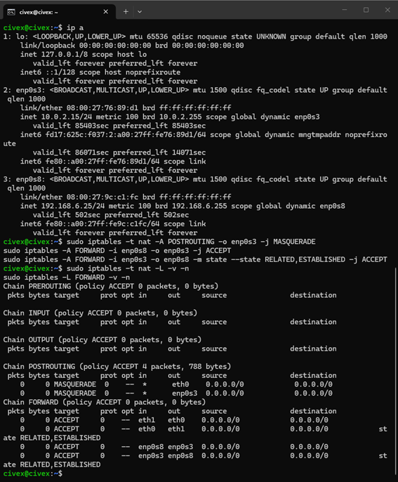

**2. Configuración del servicio dnsmasq:**
Archivo de configuración donde se define la interfaz de escucha, el rango DHCP y el reenvío de peticiones DNS.
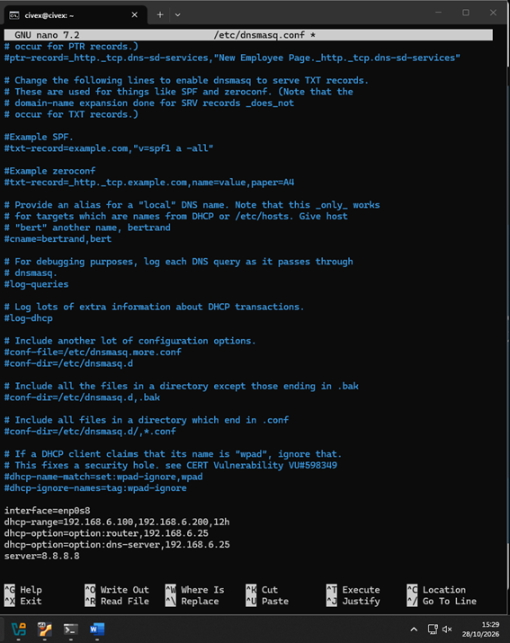

**3. Comprobación de direcciones IP y configuración de NAT (iptables):**
Asignación de IPs en ambas interfaces y aplicación de las reglas de enmascaramiento (MASQUERADE) y permisos en la cadena FORWARD.
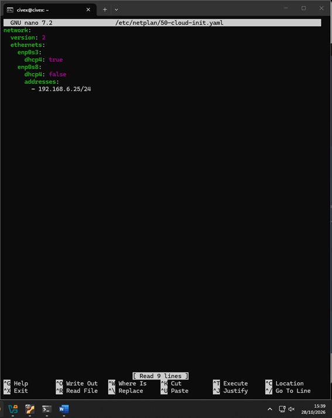

**4. Verificación de la tabla de rutas:**
Se observa que solo existe una ruta por defecto válida a través de la interfaz NAT (`enp0s3`), evitando conflictos.
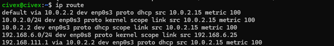

**5. Verificación de reglas NAT:**
Comprobación de que las reglas de NAT se han aplicado correctamente.
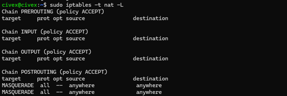

**6. Servicio dnsmasq en ejecución:**
Comprobación de que el servicio está activo (`active (running)`), mostrando el rango DHCP y el servidor DNS al que reenvía.
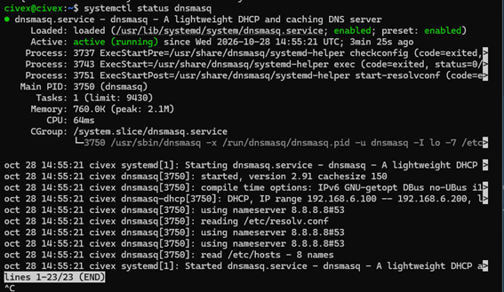

**7. Verificación de reenvío DNS (Root Servers):**
Consulta al servidor local (`dnsmasq`) para obtener la lista de servidores raíz, demostrando que el reenvío a Internet funciona.
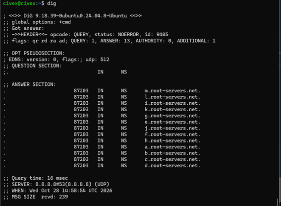

### Pruebas desde el Cliente Debian

**8. Resolución DNS con nslookup:**
El cliente pregunta al servidor (`192.168.6.25`) y obtiene las IPs correctas para `www.iana.org`.
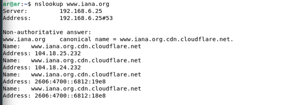

**9. Conectividad con la puerta de enlace (Servidor Ubuntu):**
Ping exitoso desde el cliente al servidor.
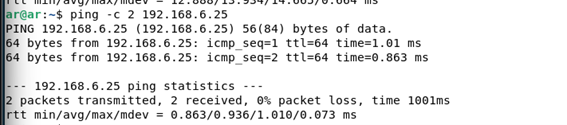

**10. Conectividad a Internet (Salida NAT):**
Ping exitoso desde el cliente a `8.8.8.8`, demostrando que el NAT del servidor está funcionando.
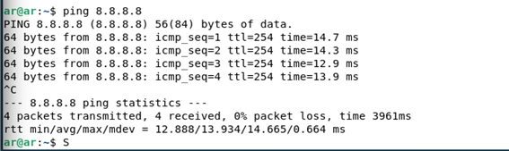

---

## 2. Tarea 1: Análisis de tráfico DNS tradicional
Para esta tarea, se han realizado peticiones a tres dominios de Internet poco habituales para evitar el cacheo previo: `www.iana.org`, `www.nlnetlabs.nl` y `www.potaroo.net`.

### Análisis detallado en Wireshark
Capturando el tráfico en la interfaz del cliente, observamos el comportamiento de cada petición:
1.  **Número de paquetes:** Cada resolución de nombre suele generar **2 paquetes de red** (un `Standard query` y un `Standard query response`). En las capturas vemos 4 paquetes por dominio, ya que se realizan consultas para registros IPv4 (Tipo A) e IPv6 (Tipo AAAA). En `iana.org` se observa además un CNAME delegando en Cloudflare.
2.  **Protocolo y Puertos:** El tráfico viaja mediante **UDP** utilizando el puerto estándar **53** (el origen es un puerto aleatorio efímero).
3.  **Seguridad y Cifrado:** Los datos **NO están cifrados**. Se puede leer en texto plano el campo `Queries` con el nombre del dominio.

**11. Wireshark - Petición a www.iana.org (Texto plano):**

**12. Wireshark - Petición a www.nlnetlabs.nl (Texto plano):**
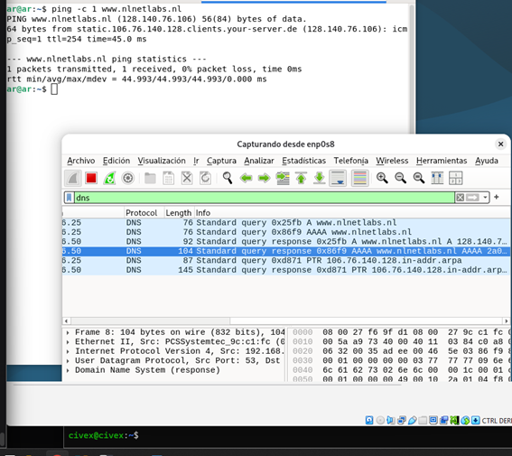

**13. Wireshark - Petición a www.potaroo.net (Texto plano):**
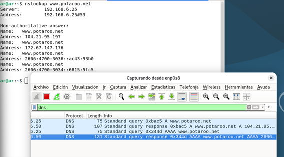

### Gráfico del camino de la petición DNS
El siguiente diagrama ilustra el recorrido de la consulta desde el cliente hasta Internet y su retorno:

**14. Diagrama del camino de la petición DNS (Draw.io):**
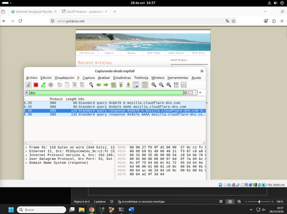

---

## 3. Tarea 2: Implementación de DNS sobre HTTPS (DoH)
Para mitigar el problema de privacidad, se ha configurado **DNS sobre HTTPS (DoH)** en el navegador Firefox del cliente, encapsulando las consultas DNS dentro de un túnel cifrado HTTPS (TLS) usando el proveedor Cloudflare.

**15. Configuración de DoH en Firefox:**
Activación del DNS sobre HTTPS en los ajustes de privacidad del navegador.
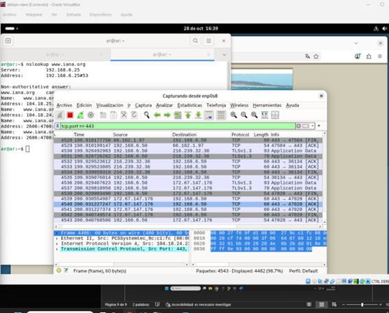

**16. Limpieza de la caché DNS del navegador:**
Se accede a `about:networking#dns` para borrar la caché y forzar nuevas consultas cifradas.
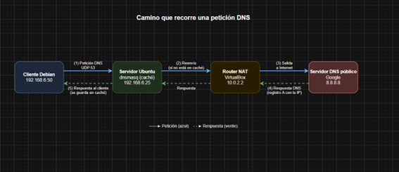

### Análisis en Wireshark tras la implementación
Tras limpiar la caché y repetir las peticiones:

1.  **Filtro `dns` (Puerto 53):** Wireshark ya **no muestra las consultas** a los dominios que estamos visitando. La única resolución DNS visible es hacia el proveedor del servicio DoH (`mozilla.cloudflare-dns.com`). Nuestro tráfico DNS ha desaparecido porque ya no viaja por el puerto 53.
2.  **Filtro `tcp.port == 443`:** Se comprueba que las consultas han sido encapsuladas dentro de tráfico **HTTPS cifrado (TLSv1.3)** hacia las IPs de Cloudflare. Para un administrador de red, es indistinguible de la navegación web normal.

**17. Wireshark - El DNS tradicional desaparece (Filtro `dns`):**
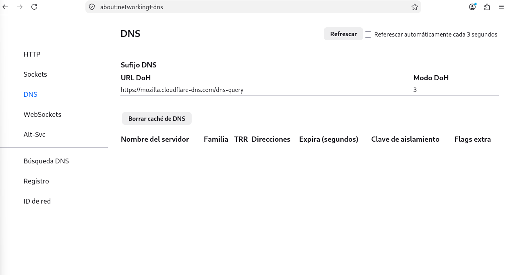

**18. Wireshark - Las consultas ahora viajan cifradas en el puerto 443:**
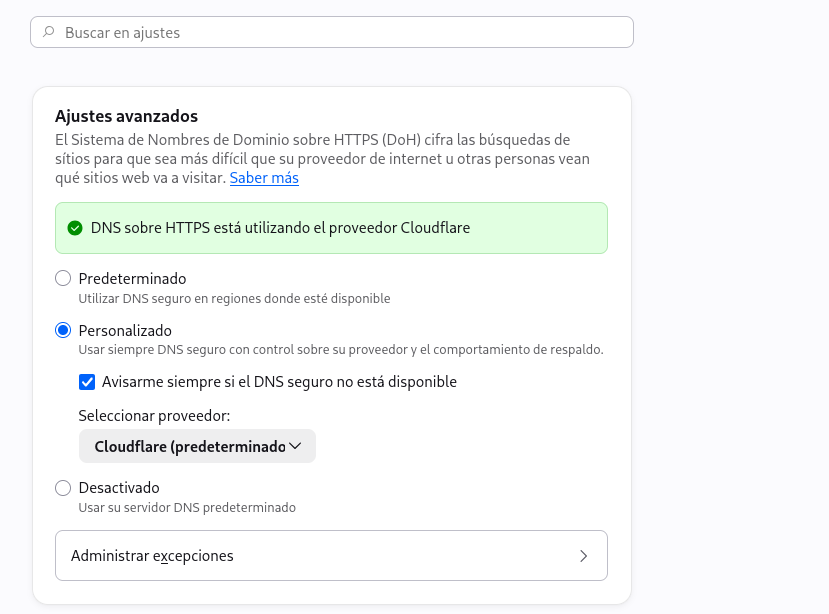

### Conclusión
La implementación de DoH demuestra una mejora drástica en la seguridad del servicio DNS. Mientras que con el DNS tradicional (Tarea 1) cualquier atacante en la red podía hacer *sniffing* y descubrir los hábitos de navegación, con DoH las consultas viajan cifradas. Esto evita ataques de espionaje e incluso ataques *Man-in-the-Middle* (MitM) donde se pudiera falsificar la respuesta DNS para redirigir el tráfico.
