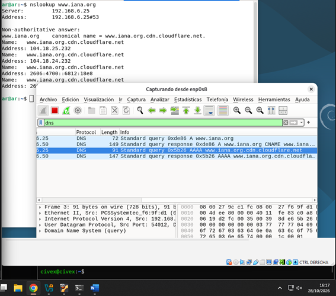

# Práctica: Seguridad en el DNS
**Módulo 037 Seguridad en servicios - Ciclo Formativo ASIX**

## 1. Entorno e Infraestructura
Para la realización de esta práctica se ha desplegado un laboratorio con dos máquinas virtuales interconectadas a través de una Red Interna en VirtualBox, simulando una red corporativa aislada.

*   **Ubuntu Server (Rol: Servidor DNS, DHCP y Router NAT):**
    *   **Adaptador 1 (NAT - `enp0s3`):** Obtiene IP dinámica (`10.0.2.15`) y proporciona salida a Internet al servidor.
    *   **Adaptador 2 (Red Interna - `enp0s8`):** IP estática `192.168.6.25`. Actúa como puerta de enlace para el cliente.
    *   **Servicios y Configuración:** Se ha habilitado el enrutamiento IP (`ip_forward=1`), se han configurado reglas de `iptables` para el NAT (MASQUERADE) y se ha instalado `dnsmasq` para actuar como servidor DHCP y DNS reenviador (hacia 8.8.8.8).
*   **Debian 13 (Rol: Cliente):**
    *   **Adaptador 1 (Red Interna - `enp0s8`):** IP estática `192.168.6.50`. Su puerta de enlace y servidor DNS apuntan directamente a la IP del servidor Ubuntu (`192.168.6.25`).

**Configuración de red en el servidor (Netplan):**

**Configuración de NAT con iptables:**

**Configuración del servicio dnsmasq:**

**Verificación de la tabla de rutas del servidor (única ruta por defecto):**

**Servicio dnsmasq en ejecución y comprobación de puertos:**

**Verificación del reenvío DNS consultando los servidores raíz (Root Servers):**

**Pruebas de conectividad y resolución desde el cliente Debian (Ping y nslookup):**

---

## 2. Tarea 1: Análisis de tráfico DNS tradicional
Para esta tarea, se han realizado peticiones a tres dominios de Internet poco habituales para evitar el cacheo previo: `www.iana.org`, `www.nlnetlabs.nl` y `www.potaroo.net`.

### Análisis detallado en Wireshark
Capturando el tráfico en la interfaz del cliente, observamos el comportamiento de cada petición:
1.  **Número de paquetes:** Cada resolución de nombre completa suele generar al menos **2 paquetes de red** (un `Standard query` de petición y un `Standard query response` de respuesta). En nuestras capturas vemos 4 paquetes por dominio, ya que se realizan consultas para registros IPv4 (Tipo A) e IPv6 (Tipo AAAA). Además, en `iana.org` se observa una respuesta CNAME, ya que delega en la CDN de Cloudflare.
2.  **Protocolo y Puertos:** El tráfico viaja mediante **UDP** (protocolo no orientado a conexión, ideal por su velocidad) y utiliza el puerto estándar **53** tanto en origen como en destino (el origen suele ser un puerto aleatorio efímero).
3.  **Seguridad y Cifrado:** Los datos **NO están cifrados**. Al inspeccionar el paquete en Wireshark, se puede leer en texto plano el campo `Queries` con el nombre del dominio al que el cliente desea acceder.

**Wireshark - Petición a www.iana.org (Visible en texto plano el CNAME):**

**Wireshark - Petición a www.nlnetlabs.nl (Peticiones A y AAAA):**

**Wireshark - Petición a www.potaroo.net:**

### Gráfico del camino de la petición DNS
El siguiente diagrama ilustra el recorrido que realiza la consulta DNS desde el cliente hasta que recibe la respuesta, pasando por nuestro servidor reenviador y el NAT hacia Internet:

---

## 3. Tarea 2: Implementación de DNS sobre HTTPS (DoH)
Para mitigar el problema de privacidad detectado en la Tarea 1, se ha procedido a configurar **DNS sobre HTTPS (DoH)**. Esta tecnología encapsula las consultas DNS tradicionales dentro de un túnel cifrado HTTPS (TLS).

### Configuración en el navegador
Se ha utilizado el navegador **Firefox** en el cliente Debian. En el menú *Ajustes -> Privacidad y seguridad -> DNS sobre HTTPS*, se ha activado la opción de "Máxima protección" utilizando el proveedor **Cloudflare**.

**Configuración de DoH en Firefox:**

### Análisis en Wireshark tras la implementación
Tras limpiar la caché DNS del navegador y repetir las peticiones a los dominios (utilizando la barra de direcciones del navegador), realizamos una nueva captura:

1.  **Filtro `dns` (Puerto 53):** Wireshark ya **no muestra las consultas** a `www.iana.org`, `www.potaroo.net`, etc. Si observamos el tráfico, solo vemos pequeñas consultas hacia el propio dominio del proveedor DoH (`mozilla.cloudflare-dns.com`). El resto de tráfico DNS ha desaparecido de nuestra vista porque ya no viaja por el puerto 53, sino encapsulado en el 443.
2.  **Filtro `tcp.port == 443`:** Al cambiar el filtro, comprobamos que se ha generado abundante tráfico **TLSv1.3** (HTTPS) hacia direcciones IP de Cloudflare. Ahí es donde viajan nuestras consultas cifradas. Para un administrador de red, este tráfico es indistinguible de una navegación web normal, garantizando la confidencialidad.

**Wireshark - El DNS tradicional desaparece (Filtro `dns`):**

**Wireshark - Las consultas ahora viajan cifradas en el puerto 443 (Filtro TLS/HTTPS):**

### Conclusión
La implementación de DoH demuestra una mejora drástica en la seguridad del servicio DNS. Mientras que en la Tarea 1 cualquier atacante en la red (o el propio administrador) podía hacer *sniffing* y descubrir los hábitos de navegación del usuario, con DoH las consultas viajan cifradas. Esto evita ataques de espionaje e incluso ataques de tipo *Man-in-the-Middle* (MitM) donde un atacante pudiera intentar falsificar la respuesta DNS para redirigir el tráfico.
